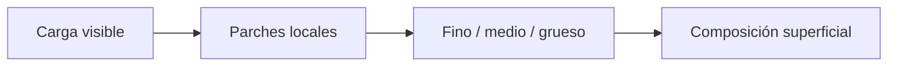
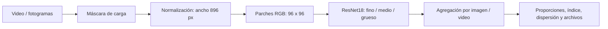

# Granulometría visual en tolva

[English](README.md) · [Demo](#probar-la-demo) · [Evaluación](docs/EVALUATION.md) · [Documentación](docs/guides/QUICKSTART.md)

[](https://github.com/sebargith/Granulometria-Tolva/actions/workflows/tests.yml)

Proyecto experimental de visión computacional para estimar la proporción visual de material **fino, medio y grueso** en la superficie visible de la carga de camiones mineros. Integra segmentación, normalización, clasificación de parches con ResNet18 y resultados por imagen y video en una aplicación Streamlit.

**Describe la superficie visible, no tamaños en milímetros ni la distribución de tamaños de todo el volumen transportado.**

## Ejemplo visual




*Esquema conceptual y etiquetas sintéticas. Las clases de los parches se reúnen para describir la superficie de la carga; esta imagen no es una predicción real.*

## Resultados

| Experimento | Unidad de evaluación | F1 macro | Exactitud |
| --- | --- | ---: | ---: |
| OpenCV + Random Forest | 357 parches de prueba | 0,697 | 69,2 % |
| RGB + ResNet18 | Los mismos 357 parches | **0,757** | **75,4 %** |
| Prueba técnica del flujo completo | 90 imágenes completas | 0,763 | 76,7 % |

Se revisaron 2.455 registros; 2.428 parches de 90 imágenes pasan el filtrado. La partición del clasificador se agrupa por imagen de origen. La prueba técnica utiliza otras 90 imágenes con referencia de clase dominante visual; no se ha establecido independencia por video o camión.


Son resultados experimentales, no una evaluación de producción ni entre minas distintas. Tras seleccionar parámetros, Random Forest se reajusta con entrenamiento y validación; ResNet18 conserva el mejor checkpoint de validación. [Protocolo y análisis de errores](docs/EVALUATION.md).

## Mi participación

Desarrollé el proyecto desde la preparación de datos hasta su implementación y evaluación, incluido el entrenamiento del modelo de segmentación utilizado por ambas ramas. En Granulometría trabajé en:

- Normalización de la carga y extracción de parches con registro de su imagen y posición de origen.
- Etiquetado contextual, anotaciones asistidas por IA y revisión humana en Streamlit.
- Una referencia con Random Forest, entrenamiento por transferencia de ResNet18 y evaluación agrupada por imagen.
- Indicadores de composición, agregación por video, visualizaciones y exportación de resultados.

El mismo modelo entrenado de segmentación sirve a Cono de Carga. Cada rama tiene su configuración de inferencia y su analítico; compartir el modelo no implica usar exactamente el mismo archivo de máscara ni ejecutar ambas ramas juntas.

## Cómo funciona



El clasificador asigna fino, medio o grueso a cada parche válido. Sus conteos entregan proporciones; la clase dominante, el índice visual y la dispersión resumen cada imagen y video. Las clases son categorías de apariencia relativa, no diámetros físicos.

Tecnologías: Python, OpenCV, PyTorch, ResNet18, scikit-learn, YOLO para segmentación y Streamlit.

## Probar la demo

Desde una copia del repositorio, con Python 3.10 o 3.11:

```sh
python scripts/demo_portfolio.py --output outputs/portfolio_demo.html
```

Abrir el HTML generado en el navegador. Incluye resultados registrados y mapas sintéticos con agregación temporal. No necesita paquetes adicionales, GPU, pesos, imágenes de la mina ni servidor. **No ejecuta inferencia de YOLO o ResNet18.** [Alcance de la demo](examples/README.md).

La inferencia completa requiere artefactos privados. Consultar [instalación](docs/guides/QUICKSTART.md) y [artefactos externos](docs/guides/ARTEFACTOS_EXTERNOS.md). No se ofrece descarga pública de pesos o datasets.

## Código y documentación

| Componente | Entrada |
| --- | --- |
| Segmentación, normalización e inferencia | [Flujo por imagen](modelos%20granulometria/inferencia_tolva/predict_granulometria_tolva.py) |
| Entrenamiento por transferencia | [ResNet18](modelos%20granulometria/clasificador_patches/train_resnet.py) |
| Referencia con descriptores manuales | [Random Forest](modelos%20granulometria/clasificador_patches/train_random_forest.py) |
| Validación de etiquetas | [Compilación del dataset](scripts/labeling/compile_grid_ai_labels.py) |
| Índice y dispersión | [Métricas](src/granulometria/metrics.py) |
| Revisión e interfaz de video | [Streamlit](tools/patch_labeler/app.py) |

[Ficha del modelo](docs/MODEL_CARD.md) · [Pruebas automatizadas](docs/guides/QUICKSTART.md#tests)

```sh
python -m unittest discover -s tests -v
```

## Limitaciones y siguiente paso

Perspectiva, oclusiones, polvo, iluminación y ambigüedad del etiquetado afectan las predicciones. Normalizar el ancho reduce diferencias de escala, pero no calibra tamaños físicos. Los puntajes softmax no están calibrados como probabilidad de acierto. Los fotogramas repetidos pueden dar demasiado peso a un momento del video. Medio es la clase más difícil: tiene 60 % de recall en la prueba técnica.

La siguiente evaluación debería separar camiones, videos o sesiones completas, fijar modelos y umbrales antes de evaluar, y reportar rendimiento, cobertura, abstención y latencia por condición. [Plan de evaluación](docs/EVALUATION.md#next-evaluation).

## Contexto y publicación

Memoria de título desarrollada junto a PSINet y la Universidad de Concepción, con datos operacionales de Collahuasi. Estado actual: prototipo experimental local. [Cono de Carga](https://github.com/sebargith/Cono-de-Carga) es el proyecto complementario: describe la forma visible, mientras este analítico describe la composición superficial. Sus métricas corresponden a tareas diferentes y no deben compararse como un ranking.

Los documentos internos, pesos e imágenes operacionales se conservan localmente en la versión actual. La demo pública usa resultados agregados y datos sintéticos; no permite reproducir la evaluación original sin sus datos. [Límites de publicación e historial](docs/PUBLICATION.md).
