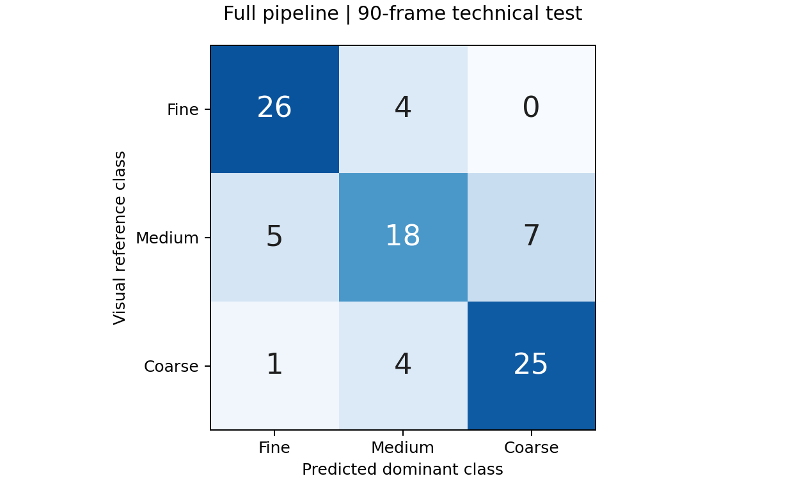
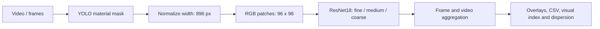
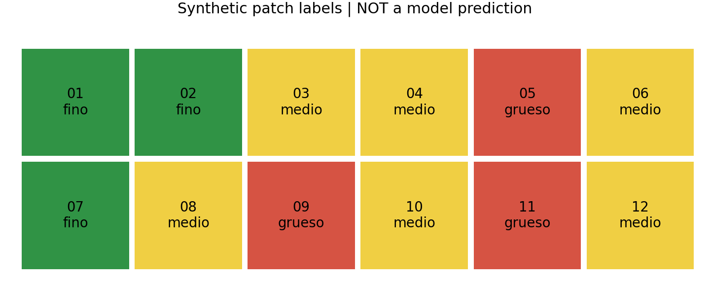

# Visual Granulometry in Haul Trucks

[Español](README.es.md) · [Evaluation](docs/EVALUATION.md) · [Quickstart](docs/guides/QUICKSTART.md) · [Model card](docs/MODEL_CARD.md)


An experimental computer vision pipeline estimating **fine, medium and coarse
visual composition of material visible in mining haul trucks**. YOLO segmentation,
normalized RGB patches, ResNet18 and frame/video aggregation are integrated in a
local Streamlit application.

The output describes the visible surface, **not sizes in millimetres or the
particle-size distribution of the entire load**.

## Results

| Experiment | Evaluation unit | Macro F1 | Accuracy |
|---|---|---:|---:|
| OpenCV + Random Forest | 357 held-out patches | 0.697 | 69.2% |
| RGB + ResNet18 | Same 357 held-out patches | **0.757** | **75.4%** |
| Full pipeline technical test | 90 complete frames | 0.763 | 76.7% |

**2,455 annotations**, of which **2,428 patches from 90 frames** pass filtering.
Classifier splits are grouped by source frame. The technical test is a separate
90-frame evaluation against visual dominant-class labels; independence by video
or truck has not been established.



These are experimental results, not a production or cross-site benchmark.
[Protocol and error analysis](docs/EVALUATION.md) explain the RF train+validation
refit versus CNN validation-checkpoint selection.

## Pipeline



## Engineering contributions

- Load normalization and mask-aware patch extraction with source/position traceability.
- Contextual grid labeling, AI-assisted annotations and human review in Streamlit.
- RF baseline, transfer learning and explicit grouped evaluation for ResNet18.
- Composition indicators, video aggregation, reviewable overlays and exports.
- Integration with shared perception: the YOLO checkpoint was **provided by PSINET**
  and also serves [Cono de Carga](https://github.com/sebargith/Cono-de-Carga).
  Training that checkpoint is not claimed as a contribution here.

Developed in a thesis collaboration with PSINET and Universidad de Concepción,
using operational data from Collahuasi. Current status: local research prototype.

## Try it without private data

From a clone, with Python 3.10 or 3.11:

```sh
python scripts/demo_portfolio.py --output outputs/portfolio_demo.html
```

Open the HTML file in a browser. It includes recorded evaluation results and
**explicitly synthetic** patch maps and temporal aggregation. No packages, GPU,
weights, mine imagery or server are required. It does not execute YOLO or ResNet
inference. [Demo scope](examples/README.md).



Full inference requires private artifacts. See [installation](docs/guides/QUICKSTART.md)
and the [artifact manifest](docs/guides/ARTEFACTOS_EXTERNOS.md). No public weights
or dataset download is currently available.

## Code tour

| Component | Entry point |
|---|---|
| Segmentation, normalization, inference | [Image pipeline](modelos%20granulometria/inferencia_tolva/predict_granulometria_tolva.py) |
| Transfer learning | [ResNet trainer](modelos%20granulometria/clasificador_patches/train_resnet.py) |
| Handcrafted-feature baseline | [RF trainer](modelos%20granulometria/clasificador_patches/train_random_forest.py) |
| Label validation | [Dataset compiler](scripts/labeling/compile_grid_ai_labels.py) |
| Visual index and dispersion | [Metrics](src/granulometria/metrics.py) |
| Review and video UI | [Streamlit app](tools/patch_labeler/app.py) |

## Limitations and next experiment

Perspective, occlusion, dust, lighting and annotation ambiguity affect predictions.
Width normalization reduces scale variation without physical calibration. Softmax
confidence is uncalibrated. Repeated frames can overweight one moment in video
aggregation. Medium is the hardest class (60% technical-test recall).

The next evaluation should hold out entire trucks/videos or capture sessions,
freeze models and thresholds before testing, and report performance, coverage,
abstention and latency by condition. [Evaluation roadmap](docs/EVALUATION.md#next-evaluation).

## Development and publication

```sh
python -m unittest discover -s tests -v
```

[Integration checks](docs/guides/QUICKSTART.md#tests) exercise actual dataset and
inference helpers with synthetic inputs. Internal deliverables and operational
imagery remain local. See [publication boundaries and historical exposure](docs/PUBLICATION.md).
